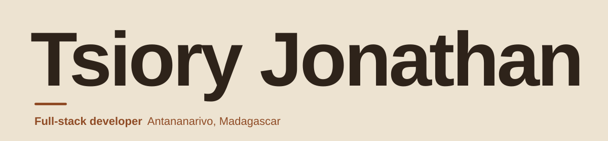
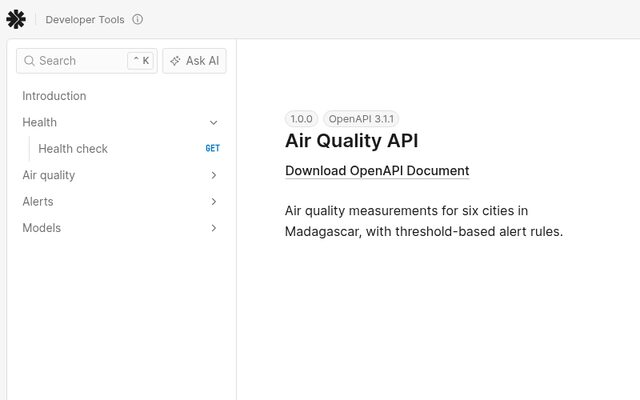
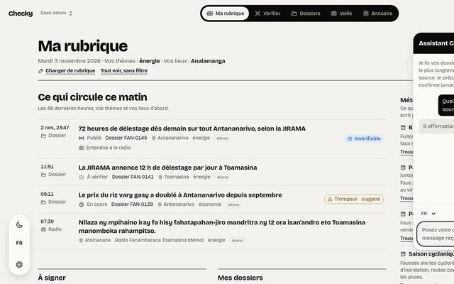
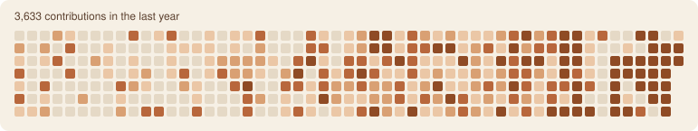

<picture>
  <source media="(prefers-color-scheme: dark)" srcset="https://raw.githubusercontent.com/TsioryJonathan/TsioryJonathan/main/assets/banner-dark.svg?v=2">
  
</picture>

Third-year software student at HEI. I build web apps from the database to the screen, tested and shipped through CI.

**2026:** 1st CTF Madagascar CyberFest (pair) · 2nd WebCup Madagascar · 3rd FANILO Hackathon

<a href="https://tsiory-jonathan.is-a.dev">
  <picture>
    <source media="(prefers-color-scheme: dark)" srcset="https://raw.githubusercontent.com/TsioryJonathan/TsioryJonathan/main/assets/portfolio-dark.svg">
    
  </picture>
</a>

<table>
<tr>
<td width="33%" valign="top">

 <b><a href="https://github.com/TsioryJonathan/karama-ko">Karama-Ko</a></b>
 Salary calculator for Madagascar, with 150+ tests and end-to-end checks.
 React · TypeScript · Vite · Playwright
</td>
<td width="33%" valign="top">

 <b><a href="https://github.com/TsioryJonathan/air-quality-api">Air Quality API</a></b>
 REST API on air quality data from six cities, with alert rules.
 C# · ASP.NET Core · EF Core · PostgreSQL · xUnit
</td>
<td width="33%" valign="top">

 <b><a href="https://github.com/0nlyDevs/checky-platform">Checky</a></b>
 Fact-checking for newsrooms. 3rd at FANILO, team of 4.
 Next.js · FastAPI · PostgreSQL
</td>
</tr>
</table>

<picture>
  <source media="(prefers-color-scheme: dark)" srcset="https://raw.githubusercontent.com/TsioryJonathan/TsioryJonathan/main/assets/contributions-dark.svg">
  
</picture>

[All projects](https://github.com/TsioryJonathan?tab=repositories) · [0nlyDevs](https://github.com/0nlyDevs)
