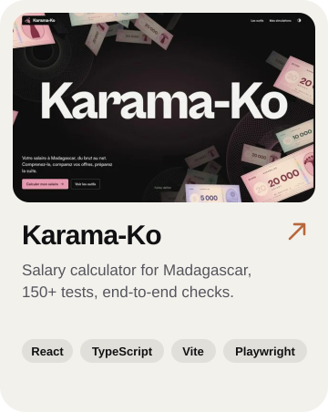
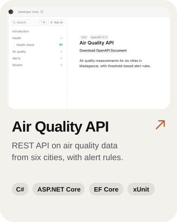
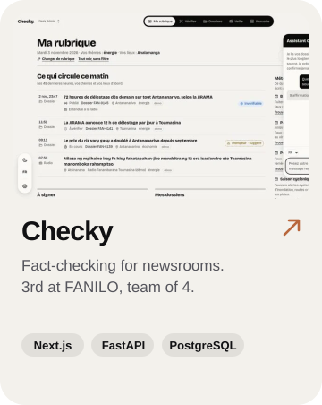

<picture>
  <source media="(prefers-color-scheme: dark)" srcset="https://raw.githubusercontent.com/TsioryJonathan/TsioryJonathan/main/assets/header-dark.svg?v=7">
  
</picture>

<a href="https://tsiory-jonathan.is-a.dev">
  <picture>
    <source media="(prefers-color-scheme: dark)" srcset="https://raw.githubusercontent.com/TsioryJonathan/TsioryJonathan/main/assets/portfolio-button-dark.svg?v=6">
    
  </picture>
</a>

<a href="https://github.com/TsioryJonathan/karama-ko"><picture>
  <source media="(prefers-color-scheme: dark)" srcset="https://raw.githubusercontent.com/TsioryJonathan/TsioryJonathan/main/assets/card-karama-ko-dark.svg">
  
</picture></a>
<a href="https://github.com/TsioryJonathan/air-quality-api"><picture>
  <source media="(prefers-color-scheme: dark)" srcset="https://raw.githubusercontent.com/TsioryJonathan/TsioryJonathan/main/assets/card-air-quality-api-dark.svg">
  
</picture></a>
<a href="https://github.com/0nlyDevs/checky-platform"><picture>
  <source media="(prefers-color-scheme: dark)" srcset="https://raw.githubusercontent.com/TsioryJonathan/TsioryJonathan/main/assets/card-checky-dark.svg">
  
</picture></a>

<a href="https://github.com/TsioryJonathan?tab=repositories">All projects</a> · <a href="https://github.com/0nlyDevs">0nlyDevs</a>

